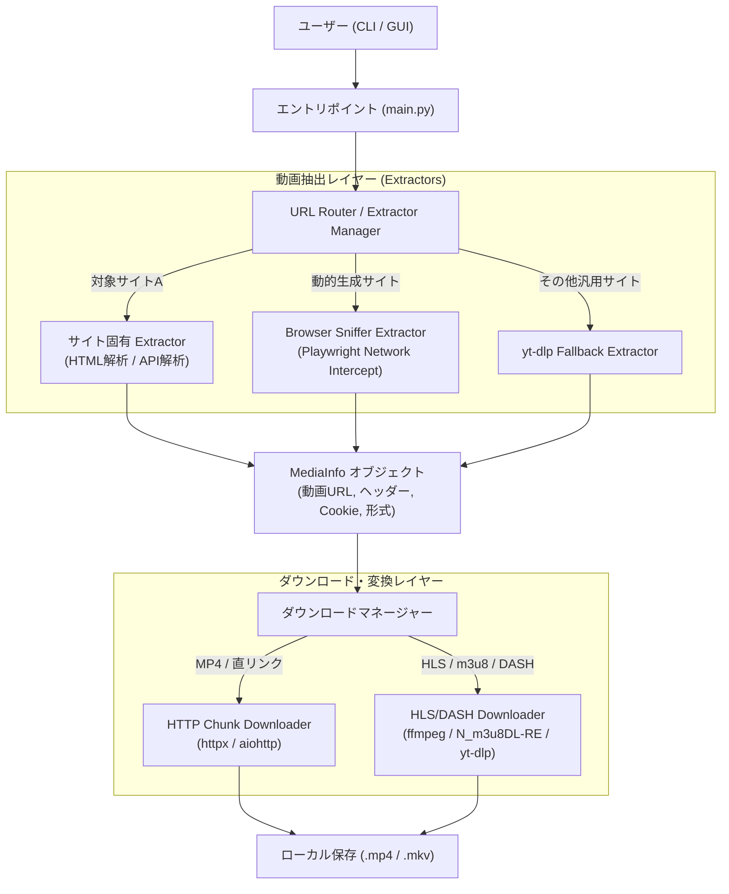

# Custom Video Downloader 設計書 (README)

## 1. 概要 (Overview)

本プロジェクトは、特定のWebページURLを入力として、ページ内に埋め込まれた動画をローカルPCにダウンロードするPython製ツールです。
`yt-dlp` などの既存ツールでは標準対応していないサイトや、動的なJavaScriptレンダリング・独自のトークン認証・難読化されたストリームURLを使用するサイトを対象とし、最終的に **Pythonランタイムを同梱したスタンドアロン実行可能パッケージ（`.exe` 等）** として配布・実行できる構成を目指します。

---

## 2. システム要件・目的 (Requirements)

### 2.1 機能要件
1. **URL入力と動画検出**
   - 単一URLまたは複数URL（テキストファイル/コマンドライン引数）の入力受付
   - サイト固有のカスタムExtractor（抽出器）による動画ストリームURLの特定
   - 動的サイト向けのブラウザ自動化（Playwright / Selenium等）を用いたネットワーク通信（`.m3u8`, `.mpd`, `.mp4` 等）のインターセプト機能
   - 汎用フォールバックとして `yt-dlp` ライブラリとの連携
2. **ストリームのダウンロードと結合**
   - HTTP/HTTPS 直リンク動画（`.mp4`, `.webm` 等）のマルチスレッド/チャンクダウンロード
   - HLS (`m3u8`) / DASH (`mpd`) 等の分割ストリームのダウンロードとTS/MP4コンテナへの結合（`ffmpeg` 連携またはネイティブ処理）
   - AES-128等の標準的なHLS暗号化ストリームの復号対応
3. **認証・ヘッダー制御**
   - User-Agent、Referer、Origin、カスタムヘッダーの自動付与
   - Cookie（ブラウザからのインポート、またはNetscape形式Cookieファイル）の読み込み対応
4. **進捗表示・ログ出力**
   - ダウンロード速度、残り時間、進捗率のプログレスバー表示
   - エラー発生時の詳細デバッグログ出力

### 2.2 非機能要件・配布要件
1. **ランタイム同梱パッケージング**
   - 実行環境にPythonがインストールされていなくても動作する単一フォルダまたは単一実行ファイル（Windows `.exe`）の生成
   - 必要な外部バイナリ（`ffmpeg` やヘッドレスブラウザバイナリ等）の同梱・パス自動解決
2. **拡張性（プラグインアーキテクチャ）**
   - 新しい対象サイトが増えた際、`extractors/` ディレクトリにサイト別のモジュールを追加するだけで対応可能な設計

---

## 3. システムアーキテクチャ (Architecture)



---

## 4. ディレクトリ構成案 (Directory Structure)

```text
video-downloader/
├── README.md                  # 本設計書・ドキュメント
├── pyproject.toml             # 依存パッケージ・ビルド定義
├── requirements.txt           # 依存ライブラリ一覧
├── build.py                   # PyInstaller パッケージング用ビルドスクリプト
├── bin/                       # 同梱用外部バイナリ配置先 (ffmpeg.exe 等)
├── src/
│   └── vdl/
│       ├── __init__.py
│       ├── __main__.py        # CLI エントリポイント
│       ├── cli.py             # コマンドライン引数解析 (argparse / click)
│       ├── config.py          # 設定管理・実行パス解決 (PyInstaller対応)
│       ├── models.py          # MediaInfo, StreamFormat 等のデータクラス
│       ├── extractors/        # サイト別動画URL抽出モジュール群
│       │   ├── __init__.py    # Extractor登録・URLルーティング
│       │   ├── base.py        # BaseExtractor 抽象基底クラス
│       │   ├── generic_sniffer.py # ヘッドレスブラウザによる通信キャプチャ抽出器
│       │   └── site_custom.py # 対象サイト専用カスタム抽出器
│       ├── downloader/        # ダウンロード実行エンジン
│       │   ├── __init__.py
│       │   ├── http.py        # 直リンク・プログレッシブダウンロード
│       │   └── hls.py         # HLS (m3u8) / FFmpeg 連携ダウンロード
│       └── utils/
│           ├── __init__.py
│           ├── logger.py      # ロギング設定
│           └── paths.py       # ランタイム同梱時のリソースパス解決 (sys._MEIPASS)
└── tests/                     # ユニットテスト・結合テスト
```

---

## 5. 主要技術スタック (Tech Stack)

| カテゴリ | 採用候補ライブラリ / ツール | 用途・選定理由 |
| :--- | :--- | :--- |
| **言語** | Python 3.11+ | エコシステムが豊富でスクレイピング・通信処理に最適 |
| **HTTP通信** | `httpx` または `curl_cffi` | HTTP/2対応、およびCloudflare等のTLSフィンガープリント検知回避（`curl_cffi`） |
| **HTML解析** | `BeautifulSoup4` + `lxml` | 高速なDOMパースとメタデータ抽出 |
| **ブラウザ自動化** | `Playwright` (または `Selenium`) | 動的JSレンダリングや通信インターセプトによる `.m3u8` / `.mp4` 抽出 |
| **ダウンロード補助** | `yt-dlp`, `ffmpeg` | HLS/DASHの高速結合・汎用ストリーム処理 |
| **CLI / UI表示** | `rich` | プログレスバー、カラーログ表示 |
| **パッケージング** | `PyInstaller` (または `Nuitka`) | Pythonランタイム・依存ライブラリ・`ffmpeg` を同梱した実行ファイル作成 |

---

## 6. 動画抽出アプローチ詳細 (Extraction Strategies)

`yt-dlp` でダウンロードできないサイトには主に以下のパターンがあり、段階的に対応します。

1. **Level 1: 静的HTML / 埋め込みJSON解析 (`CustomExtractor`)**
   - ページ内の `<script>` タグや非公開APIエンドポイントから動画マニフェストURLとトークンを正規表現・JSONパースで抽出し、適切な `Referer` / `User-Agent` ヘッダーを付与してダウンロードします。
2. **Level 2: TLSフィンガープリント・Bot対策回避 (`curl_cffi`)**
   - 標準の `requests` や `urllib` がWAF（Cloudflare等）にブロックされる場合、ChromeのTLSフィンガープリントを模倣する `curl_cffi` を使用してリクエストを行います。
3. **Level 3: ヘッドレスブラウザによるネットワークスニッフィング (`BrowserSnifferExtractor`)**
   - 難読化されたJavaScriptプレイヤーが動的に生成するストリームに対し、Playwright等でページを開き、`page.on("response", ...)` で `.m3u8` / `.mpd` / `.mp4` の通信とリクエストヘッダーを丸ごとキャプチャしてダウンローダーへ引き渡します。

---

## 7. Pythonランタイム同梱パッケージング設計 (Packaging)

PythonがインストールされていないPCでも動作させるため、以下の構成でパッケージングを行います。

- **ビルドツール**: `PyInstaller`
- **パッケージ形態**:
  - **One-Directory モード (`--onedir`)** *(推奨)*: 起動速度が速く、`ffmpeg.exe` やブラウザバイナリ、設定ファイルの管理・差し替えが容易。配布時はZIPアーカイブ化。
  - **One-File モード (`--onefile`)**: 単一の `.exe` ファイルにすべてを圧縮同梱（起動時に一時フォルダへ展開）。
- **リソースパス解決**:
  - 開発時とパッケージ実行時（`getattr(sys, 'frozen', False)`）を自動判定するヘルパー関数を実装し、同梱された `bin/ffmpeg.exe` などを確実に参照できるようにします。

---

## 8. CLI インターフェース仕様案 (CLI Usage)

```bash
# 基本的な使用方法（URLを指定してカレントディレクトリへ保存）
vdl "https://example.com/watch/12345"

# 保存先ディレクトリと出力ファイル名テンプレートの指定
vdl "https://example.com/watch/12345" -o "./downloads/%(title)s.%(ext)s"

# ブラウザCookieやカスタムヘッダーを使用する場合
vdl "https://example.com/watch/12345" --cookies cookies.txt

# ヘッドレスブラウザによるスニッフィングモードを強制する場合
vdl "https://example.com/watch/12345" --use-browser
```

---

## 9. 実装ロードマップ (Roadmap)

1. **Phase 1: 要件定義・対象サイト分析（現在）**
   - 設計書（README）の作成
   - 対象サイトの仕様確認（ストリーム形式、認証方式、DRMの有無）
2. **Phase 2: コアフレームワーク実装**
   - CLI基盤、設定管理、`BaseExtractor`、HTTP/HLSダウンローダーの実装
3. **Phase 3: 対象サイト専用Extractorの実装**
   - ターゲットサイト向けのスクレイピングまたはブラウザスニッフィング処理の実装・検証
4. **Phase 4: パッケージング・ビルド構成**
   - `PyInstaller` ビルドスクリプトの作成とスタンドアロン動作確認

